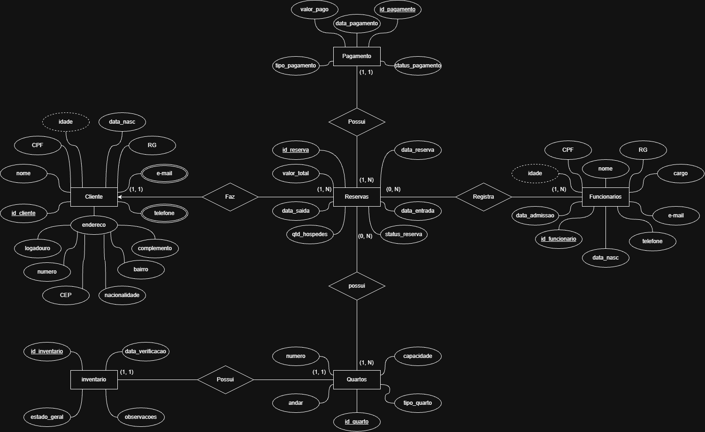
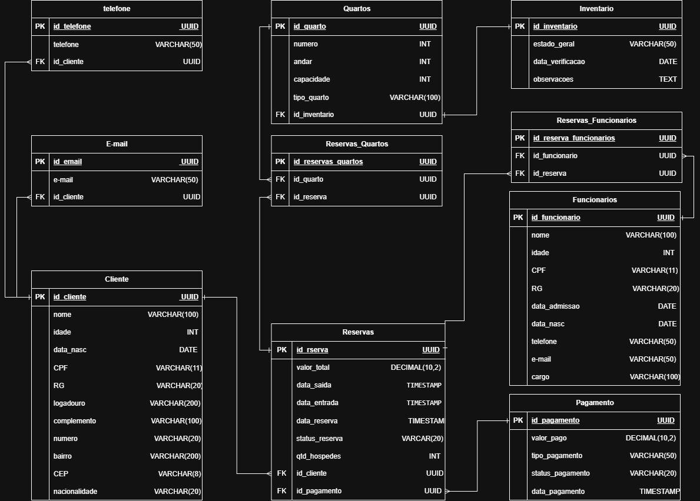

# Modelagem de Banco de Dados — Hotel Alola

Projeto acadêmico desenvolvido para a disciplina de **Modelagem de Banco de Dados**, com modelagem conceitual, lógica e física de um sistema de reservas hoteleiras. A implementação do banco de dados será realizada em **PostgreSQL**, utilizando a plataforma **Supabase**.

> **Status do projeto:** em desenvolvimento. Os arquivos e as evidências das etapas seguintes serão adicionados conforme a implementação.

## 1. Cenário

### 1.1. Descrição do estabelecimento

O **Hotel Alola** é um estabelecimento hoteleiro fictício que oferece serviços de hospedagem para clientes que buscam acomodações para viagens de lazer, trabalho ou outras necessidades.

O hotel dispõe de diferentes categorias de quartos, com características e capacidades variadas, permitindo que os clientes realizem reservas de uma ou mais unidades, conforme suas necessidades.

Para realizar suas atividades, o estabelecimento conta com funcionários responsáveis pelo atendimento aos clientes, registro das reservas e acompanhamento das operações internas.

Além do gerenciamento das hospedagens, o hotel mantém informações sobre seus quartos e respectivos inventários, com o objetivo de acompanhar as condições das acomodações e organizar os recursos disponíveis.

### 1.2. Problema identificado

O Hotel Alola enfrenta dificuldades para organizar e consultar as informações relacionadas às suas atividades devido à ausência de um banco de dados centralizado.

O controle descentralizado dos registros pode ocasionar duplicidade de informações, inconsistências nos cadastros de clientes, dificuldades para identificar os quartos associados a cada reserva e falta de organização dos pagamentos.

Além disso, o gerenciamento das informações dos funcionários e dos inventários dos quartos torna-se mais trabalhoso quando os dados não estão devidamente relacionados.

Outro desafio é acompanhar o histórico de reservas, principalmente porque um mesmo cliente pode realizar diferentes reservas e um quarto pode ser reservado em períodos distintos.

Diante dessas necessidades, o estabelecimento busca uma solução que organize suas informações de maneira estruturada, garantindo maior integridade, consistência e facilidade de consulta.

### 1.3. Solução proposta

Propõe-se a criação de um **banco de dados relacional para o Hotel Alola**, desenvolvido em PostgreSQL por meio do Supabase.

O banco de dados centralizará e relacionará informações de clientes, funcionários, quartos, inventários, reservas e pagamentos. Sua estrutura dará suporte ao cadastro, consulta, atualização e exclusão de registros, além da elaboração de relatórios por meio de consultas SQL.

A modelagem também contempla situações em que uma reserva envolve vários quartos e em que diferentes funcionários participam do registro de uma mesma reserva.

### 1.4. Entidades e atributos

O modelo conceitual possui **seis entidades principais**. No modelo lógico, também são utilizadas tabelas auxiliares para representar atributos multivalorados e relacionamentos muitos para muitos.

| Entidade | Finalidade | Atributos identificados |
|---|---|---|
| **Cliente** | Dados dos clientes responsáveis por reservas | `id_cliente`, nome, CPF, RG, `data_nasc`, idade (derivada), nacionalidade, endereço (composto), telefone (multivalorado), e-mail (multivalorado) |
| **Funcionários** | Dados dos profissionais do hotel | `id_funcionario`, nome, CPF, RG, `data_nasc`, idade (derivada), telefone, e-mail, cargo, `data_admissao` |
| **Quartos** | Identificação e características das acomodações | `id_quarto`, número, andar, capacidade, `tipo_quarto` |
| **Inventário** | Registro das condições de cada quarto | `id_inventario`, `data_verificacao`, `estado_geral`, observações |
| **Reservas** | Dados e situação das hospedagens reservadas | `id_reserva`, `data_reserva`, `data_entrada`, `data_saida`, `qtd_hospedes`, `valor_total`, `status_reserva` |
| **Pagamento** | Informações de pagamento das reservas | `id_pagamento`, `valor_pago`, `data_pagamento`, `tipo_pagamento`, `status_pagamento` |

**Tipos de atributos presentes:**

- **Simples:** nome, CPF, RG, cargo, capacidade, entre outros.
- **Composto:** endereço de Cliente, decomposto em logradouro, número, bairro, CEP e complemento.
- **Multivalorados:** telefone e e-mail de Cliente.
- **Derivados:** idade de Cliente e de Funcionários, calculada a partir de `data_nasc`.
- **Identificadores (chaves):** os campos `id_...` de cada entidade.

### 1.5. Regras de negócio e relacionamentos

| Relacionamento | Tipo | Regra definida para o Hotel Alola |
|---|---|---|
| Cliente — Reservas | **1:N** | Um cliente realiza uma ou mais reservas; cada reserva pertence a um cliente. |
| Funcionários — Reservas | **N:N** | Um funcionário pode registrar zero ou mais reservas; uma reserva é registrada por um ou mais funcionários. |
| Reservas — Quartos | **N:N** | Uma reserva inclui um ou mais quartos; um quarto pode aparecer em várias reservas ao longo do tempo. |
| Pagamento — Reservas | **1:N** | Uma reserva possui um pagamento; um pagamento pode abranger uma ou mais reservas. |
| Quartos — Inventário | **1:1** | Cada quarto possui um inventário exclusivo e cada inventário está associado a um único quarto. |

Um mesmo quarto não deverá ter reservas confirmadas com períodos de hospedagem sobrepostos. Essa regra depende de validação específica na implementação, além dos relacionamentos e chaves estrangeiras.

Na modelagem lógica, os relacionamentos N:N são representados por `Reservas_Quartos` e `Reservas_Funcionarios`. Os atributos multivalorados de Cliente dão origem às tabelas `telefone` e `E-mail`.

### 1.6. Objetivo do projeto

Desenvolver um banco de dados relacional para o Hotel Alola, capaz de armazenar e relacionar informações necessárias ao gerenciamento de reservas e atividades administrativas. O projeto aplica identificação de entidades, atributos, chaves e relacionamentos, transformação dos modelos conceitual e lógico em uma estrutura física PostgreSQL, operações CRUD e consultas SQL.

## 2. Modelagem Conceitual

O Diagrama Entidade-Relacionamento (DER) apresenta as entidades, os atributos e os relacionamentos do cenário, incluindo exemplos de atributos simples, compostos, multivalorados, derivados e identificadores, bem como cardinalidades 1:1, 1:N e N:N.

**Arquivo:** [`02-Modelagem-conceitual/Modelo_Conceitual.svg`](02-Modelagem-conceitual/Modelagem_conceitual_sistema_reserva_hotel.svg)



## 3. Modelagem Lógica

O modelo lógico transforma as entidades e os relacionamentos em tabelas relacionais, identificando **chaves primárias (PK)**, **chaves estrangeiras (FK)** e os tipos de dados previstos. As tabelas associativas representam os relacionamentos N:N.

**Arquivo:** [`03-modelagem-logica/Modelo_Logico.svg`](03-modelagem-logica/Modelagem_logica_sistema_reserva_hotel.drawio.svg)



## 4. Modelagem Física

A implementação será realizada em PostgreSQL, no Supabase, com os comandos de criação das tabelas, definição de tipos de dados, chaves, relacionamentos e restrições de integridade referencial.

**Arquivos desta etapa:**

- [`04-modelagem-fisica/01-criacao-tabelas.sql`](04-modelagem-fisica/01-criacao-tabelas.sql) — script de criação do banco.
- `04-modelagem-fisica/Prints/` — capturas da estrutura das tabelas e relacionamentos no Supabase.

**Status:** implementação e evidências pendentes.

## 5. Dados

Cada tabela física deverá conter **no mínimo 500 registros**, utilizando dados fictícios consistentes com o cenário e com as regras de integridade do banco.

**Arquivos desta etapa:**

- [`05-dados/01-insercao-dados.sql`](05-dados/01-insercao-dados.sql) — script para popular as tabelas.
- [`05-dados/02-verificacao-registros.sql`](05-dados/02-verificacao-registros.sql) — consultas de contagem de registros por tabela.
- `05-dados/Prints/` — capturas que demonstram os dados inseridos.

**Status:** inserção e verificação pendentes.

## 6. CRUD

Demonstração das quatro operações fundamentais no Supabase:

| Operação | Comando SQL | Finalidade |
|---|---|---|
| Create | `INSERT` | Inserir registros |
| Read | `SELECT` | Consultar registros |
| Update | `UPDATE` | Atualizar registros |
| Delete | `DELETE` | Excluir registros |

**Arquivos desta etapa:**

- [`06-CRUD/crud.sql`](06-CRUD/crud.sql) — comandos utilizados na demonstração.
- `06-CRUD/Prints/` — capturas de tela com os resultados de cada operação.

**Status:** comandos e evidências pendentes.

## 7. Relatórios

Serão desenvolvidas **10 consultas SQL** para responder a questões relevantes do Hotel Alola, utilizando `SELECT`, `WHERE`, `ORDER BY` e `JOIN`, com exploração dos relacionamentos entre as tabelas.

**Arquivos desta etapa:**

- [`07-relatorios/relatorios.sql`](07-relatorios/relatorios.sql) — as 10 consultas comentadas e organizadas.
- `07-relatorios/Prints/` — capturas dos resultados, como evidências complementares.

**Status:** consultas e resultados pendentes.

---

## Organização dos arquivos

```text
Modelagem-Banco-de-Dados-Hotel-Alola/
├── README.md
├── 01-Cenario-descricao/
│   └── .gitkeep                      
├── 02-Modelagem-conceitual/
│   └── Modelo_Conceitual.png         # adicionar imagem
├── 03-modelagem-logica/
│   └── Modelo_Logico.png             # adicionar imagem
├── 04-modelagem-fisica/
│   ├── 01-criacao-tabelas.sql        # adicionar script
│   └── Prints/                      # adicionar capturas
├── 05-dados/
│   ├── 01-insercao-dados.sql         # adicionar script
│   ├── 02-verificacao-registros.sql  # adicionar script
│   └── Prints/                      # adicionar capturas
├── 06-CRUD/
│   ├── crud.sql                     # adicionar script
│   └── Prints/                      # adicionar capturas
└── 07-relatorios/
    ├── relatorios.sql               # adicionar script
    └── Prints/                      # adicionar capturas
```
