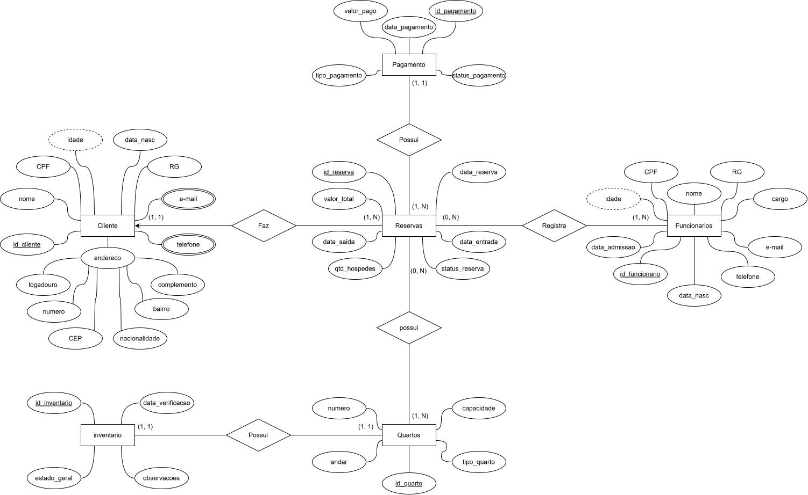
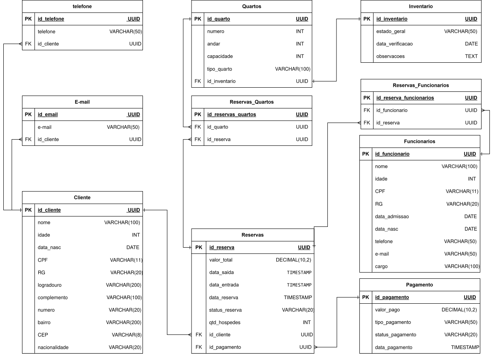

# Modelagem de Banco de Dados — Hotel Alola

Projeto acadêmico desenvolvido para a disciplina de **Modelagem de Banco de Dados**, com modelagem conceitual, lógica e física de um sistema de reservas hoteleiras. A implementação do banco de dados será realizada em **PostgreSQL**, utilizando a plataforma **Supabase**.


## Uso de Inteligência Artificial
A Inteligência Artificial foi utilizada como ferramenta de apoio na geração de dados fictícios, organização da documentação e revisão do código.

## 1. Cenário

### 1.1. Descrição do estabelecimento

O **Hotel Alola** é um estabelecimento hoteleiro fictício que oferece serviços de hospedagem para clientes que buscam acomodações para viagens de lazer, trabalho ou outras necessidades.

O hotel dispõe de diferentes categorias de quartos, com características e capacidades variadas, permitindo que os clientes realizem reservas de uma ou mais unidades, conforme suas necessidades.

Para realizar suas atividades, o estabelecimento conta com funcionários responsáveis pelo atendimento aos clientes, registro das reservas e acompanhamento das operações internas.

Além do gerenciamento das hospedagens, o hotel mantém informações sobre seus quartos e respectivos inventários, com o objetivo de acompanhar as condições das acomodações e organizar os recursos disponíveis.

### 1.2. Problema identificado

O Hotel Alola enfrenta dificuldades para organizar e consultar as informações relacionadas às suas atividades devido à ausência de um banco de dados centralizado.

O controle descentralizado dos registros pode ocasionar duplicidade de informações, inconsistências nos cadastros de clientes, dificuldades para identificar os quartos associados a cada reserva e falta de organização dos pagamentos.

Além disso, o gerenciamento das informações dos funcionários e dos inventários dos quartos torna-se mais trabalhoso quando os dados não estão devidamente relacionados.

Outro desafio é acompanhar o histórico de reservas, principalmente porque um mesmo cliente pode realizar diferentes reservas e um quarto pode ser reservado em períodos distintos.

Diante dessas necessidades, o estabelecimento busca uma solução que organize suas informações de maneira estruturada, garantindo maior integridade, consistência e facilidade de consulta.

### 1.3. Solução proposta

Propõe-se a criação de um **banco de dados relacional para o Hotel Alola**, desenvolvido em PostgreSQL por meio do Supabase.

O banco de dados centralizará e relacionará informações de clientes, funcionários, quartos, inventários, reservas e pagamentos. Sua estrutura dará suporte ao cadastro, consulta, atualização e exclusão de registros, além da elaboração de relatórios por meio de consultas SQL.

A modelagem também contempla situações em que uma reserva envolve vários quartos e em que diferentes funcionários participam do registro de uma mesma reserva.

### 1.4. Entidades e atributos

O modelo conceitual possui **seis entidades principais**. No modelo lógico, também são utilizadas tabelas auxiliares para representar atributos multivalorados e relacionamentos muitos para muitos.

| Entidade | Finalidade | Atributos identificados |
|---|---|---|
| **Cliente** | Dados dos clientes responsáveis por reservas | `id_cliente`, nome, CPF, RG, `data_nasc`, idade (derivada), nacionalidade, endereço (composto), telefone (multivalorado), e-mail (multivalorado) |
| **Funcionários** | Dados dos profissionais do hotel | `id_funcionario`, nome, CPF, RG, `data_nasc`, idade (derivada), telefone, e-mail, cargo, `data_admissao` |
| **Quartos** | Identificação e características das acomodações | `id_quarto`, número, andar, capacidade, `tipo_quarto` |
| **Inventário** | Registro das condições de cada quarto | `id_inventario`, `data_verificacao`, `estado_geral`, observações |
| **Reservas** | Dados e situação das hospedagens reservadas | `id_reserva`, `data_reserva`, `data_entrada`, `data_saida`, `qtd_hospedes`, `valor_total`, `status_reserva` |
| **Pagamento** | Informações de pagamento das reservas | `id_pagamento`, `valor_pago`, `data_pagamento`, `tipo_pagamento`, `status_pagamento` |

**Tipos de atributos presentes:**

- **Simples:** nome, CPF, RG, cargo, capacidade, entre outros.
- **Composto:** endereço de Cliente, decomposto em logradouro, número, bairro, CEP e complemento.
- **Multivalorados:** telefone e e-mail de Cliente.
- **Derivados:** idade de Cliente e de Funcionários, calculada a partir de `data_nasc`.
- **Identificadores (chaves):** os campos `id_...` de cada entidade.

### 1.5. Regras de negócio e relacionamentos

| Relacionamento | Tipo | Regra definida para o Hotel Alola |
|---|---|---|
| Cliente — Reservas | **1:N** | Um cliente realiza uma ou mais reservas; cada reserva pertence a um cliente. |
| Funcionários — Reservas | **N:N** | Um funcionário pode registrar zero ou mais reservas; uma reserva é registrada por um ou mais funcionários. |
| Reservas — Quartos | **N:N** | Uma reserva inclui um ou mais quartos; um quarto pode aparecer em várias reservas ao longo do tempo. |
| Pagamento — Reservas | **1:N** | Uma reserva possui um pagamento; um pagamento pode abranger uma ou mais reservas. |
| Quartos — Inventário | **1:1** | Cada quarto possui um inventário exclusivo e cada inventário está associado a um único quarto. |

Um mesmo quarto não deverá ter reservas confirmadas com períodos de hospedagem sobrepostos. Essa regra depende de validação específica na implementação, além dos relacionamentos e chaves estrangeiras.

Na modelagem lógica, os relacionamentos N:N são representados por `Reservas_Quartos` e `Reservas_Funcionarios`. Os atributos multivalorados de Cliente dão origem às tabelas `telefone` e `E-mail`.

### 1.6. Objetivo do projeto

Desenvolver um banco de dados relacional para o Hotel Alola, capaz de armazenar e relacionar informações necessárias ao gerenciamento de reservas e atividades administrativas. O projeto aplica identificação de entidades, atributos, chaves e relacionamentos, transformação dos modelos conceitual e lógico em uma estrutura física PostgreSQL, operações CRUD e consultas SQL.

### 1.7. Documentação do cenário

A descrição completa do cenário do Hotel Alola também está disponível em um documento Markdown independente, organizado na primeira pasta do repositório.

**Documento:** [Cenário e descrição do Hotel Alola](01-Cenario-descricao/cenario-hotel-alola.md).

O arquivo reúne a contextualização do estabelecimento fictício, o problema identificado, a solução proposta, as entidades e seus atributos, os relacionamentos e as regras de negócio utilizadas como base para a modelagem do banco de dados.

## 2. Modelagem Conceitual

O Diagrama Entidade-Relacionamento (DER) apresenta as entidades, os atributos e os relacionamentos do cenário, incluindo exemplos de atributos simples, compostos, multivalorados, derivados e identificadores, bem como cardinalidades 1:1, 1:N e N:N.

**Arquivo:** [`02-Modelagem-conceitual/Modelo_Conceitual.png`](02-Modelagem-conceitual/Modelagem_conceitual_sistema_reserva_hotel.png)



## 3. Modelagem Lógica

O modelo lógico transforma as entidades e os relacionamentos em tabelas relacionais, identificando **chaves primárias (PK)**, **chaves estrangeiras (FK)** e os tipos de dados previstos. As tabelas associativas representam os relacionamentos N:N.

**Arquivo:** [`03-modelagem-logica/Modelo_Logico.png`](03-modelagem-logica/Modelagem_logica_sistema_reserva_hotel.drawio.png)



## 4. Modelagem Física

A implementação foi realizada em PostgreSQL, no Supabase, com os comandos de criação das tabelas, definição de tipos de dados, chaves, relacionamentos e restrições de integridade referencial.

**Arquivos desta etapa:**

- [01 — Script de criação das tabelas](04-modelagem-fisica/01-criacao-tabelas.sql) — código SQL utilizado na implementação do banco de dados.

### Evidências de implementação no Supabase

As capturas de tela demonstram a execução dos scripts, a criação das tabelas, suas estruturas e os relacionamentos estabelecidos.

- [01 — Execução do SQL](04-modelagem-fisica/Prints/01-execucao-sql.png)
- [02 — Tabelas criadas](04-modelagem-fisica/Prints/02-tabelas-criadas.png)
- [03 — Estrutura das tabelas](04-modelagem-fisica/Prints/03-estrutura-tabelas.png)
- [04 — Relacionamentos entre as tabelas](04-modelagem-fisica/Prints/04-relacionamentos.png)

**Todas as evidências:** [Visualizar pasta de prints da Modelagem Física](04-modelagem-fisica/Prints/).

## 5. Dados

Nesta etapa, foram inseridos **5.400 registros fictícios**, distribuídos entre as 10 tabelas do banco de dados do Hotel Alola, respeitando os relacionamentos e as chaves estrangeiras. (A Inteligência Artificial foi utilizada geração de dados fictícios)

Para facilitar a organização e a manutenção, os comandos de inserção foram separados em arquivos SQL individuais, um para cada tabela.

### Arquivos desta etapa

**Scripts de inserção:**

- [01.1 — Clientes](05-dados/01-insercao-cliente.sql)
- [01.2 — Funcionários](05-dados/01.2-insercao-funcionarios.sql)
- [01.3 — Pagamentos](05-dados/01.3-insercao-pagamento.sql)
- [01.4 — Inventário](05-dados/01.4-insercao-inventario.sql)
- [01.5 — E-mails](05-dados/01.5-insercao-email.sql)
- [01.6 — Telefones](05-dados/01.6-insercao-telefone.sql)
- [01.7 — Quartos](05-dados/01.7-insercao-quartos.sql)
- [01.8 — Reservas](05-dados/01.8-insercao-reservas.sql)
- [01.9 — Reserva_Quartos](05-dados/01.9-insercao-reserva_quartos.sql)
- [01.10 — Reserva_Funcionarios](05-dados/01.10-insercao-reserva_funcionarios.sql)

**Verificação dos registros:**

- [02 — Verificação dos registros](05-dados/02-verificacao-registros.sql) — consultas SQL para conferir a quantidade de registros inseridos em cada tabela.

### Evidências no Supabase

A pasta [`05-dados/Prints/`](05-dados/Prints/) contém as capturas de tela das tabelas preenchidas e dos resultados da execução.

- [01 — Clientes](05-dados/Prints/01-clientes.png)
- [02 — Funcionários](05-dados/Prints/02-funcionarios.png)
- [03 — Pagamentos](05-dados/Prints/03-pagamentos.png)
- [04 — Inventários](05-dados/Prints/04-inventarios.png)
- [05 — E-mails](05-dados/Prints/05-E-mails.png)
- [06 — Telefones](05-dados/Prints/06-telefones.png)
- [07 — Quartos](05-dados/Prints/07-quartos.png)
- [08 — Reservas](05-dados/Prints/08-reservas.png)
- [09 — Reserva_Quartos](05-dados/Prints/09-reserva-quartos.png)
- [10 — Reserva_Funcionarios](05-dados/Prints/10-reserva-funcionarios.png)
- [11 — Contagem de registros](05-dados/Prints/11-contagem-registros.png)

Também foi adicionada uma captura da execução dos scripts de inserção no Supabase.

## 6. CRUD

Nesta etapa, foram implementadas e executadas as quatro operações fundamentais de manipulação de dados em um banco de dados relacional: **Create, Read, Update e Delete (CRUD)**.

As operações foram desenvolvidas utilizando comandos SQL no PostgreSQL, por meio do SQL Editor do Supabase, com foco na tabela `Cliente` do Hotel Alola.

| Operação | Comando SQL | Implementação |
|---|---|---|
| Create | `INSERT` | Cadastro de novos clientes |
| Read | `SELECT` | Consulta de clientes por CPF e nome |
| Update | `UPDATE` | Atualização das informações de endereço de um cliente |
| Delete | `DELETE` | Exclusão de um cliente e verificação posterior |

### 6.1. Scripts SQL

Para facilitar a organização, cada operação foi armazenada em um arquivo SQL independente numerado em ordem de execução.

- [01 — INSERT (Create)](06-CRUD/01-Insert.sql) — inserção de três clientes fictícios no banco de dados.
- [02 — SELECT (Read)](06-CRUD/02-select.sql) — consultas utilizando CPF e nome dos clientes.
- [03 — UPDATE (Update)](06-CRUD/03-Update.sql) — atualização dos dados de endereço de um cliente específico.
- [04 — DELETE (Delete)](06-CRUD/04-Delete.sql) — exclusão de um cliente e consulta para verificar a remoção do registro.

Os comandos utilizam cláusulas como `WHERE` para selecionar registros específicos e `RETURNING *` para exibir os registros inseridos, alterados ou excluídos.

### 6.2. Evidências de execução

As operações foram demonstradas no Supabase, com capturas de tela dos comandos e seus resultados.

- [01 — Execução do INSERT](06-CRUD/Prints/01-Insert%20%28Create%29.png)
- [02 — Execução do SELECT](06-CRUD/Prints/02-Select%20%28Read%29.png)
- [03 — Execução do UPDATE](06-CRUD/Prints/03-Update%20%28Update%29.png)
- [04 — Execução do DELETE](06-CRUD/Prints/04-%20Delete%20%28Delete%29.png)
- [05 — Verificação do DELETE](06-CRUD/Prints/05-%20Verificar%20Delete%20%28delete%29.png)

Todas as evidências estão organizadas na pasta [`06-CRUD/Prints/`](06-CRUD/Prints/).

## 7. Relatórios

Nesta etapa, foram desenvolvidas **10 consultas SQL** com o objetivo de extrair e analisar informações relevantes para o gerenciamento do Hotel Alola.

Os relatórios foram implementados em PostgreSQL, utilizando o SQL Editor do Supabase, e exploram os relacionamentos existentes entre clientes, funcionários, reservas, quartos, inventários e pagamentos.

As consultas utilizam comandos e cláusulas como `SELECT`, `WHERE`, `ORDER BY` e `JOIN`, além de funções de agregação como `COUNT()`, `SUM()` e `AVG()`, e agrupamento com `GROUP BY`.

### 7.1. Relatórios desenvolvidos

| Nº | Relatório | Finalidade |
|---|---|---|
| 01 | Clientes e suas reservas | Consultar os clientes responsáveis pelas reservas, com datas, valores e situação |
| 02 | Reservas de maior valor | Identificar as reservas mais caras registradas no hotel |
| 03 | Pagamentos confirmados | Relacionar pagamentos realizados, reservas e respectivos clientes |
| 04 | Quartos por capacidade | Consultar os quartos que comportam três ou mais hóspedes |
| 05 | Funcionários por reserva | Identificar os funcionários vinculados ao registro das reservas |
| 06 | Quartos utilizados nas reservas | Consultar os quartos associados às reservas e seus períodos |
| 07 | Clientes com mais reservas | Contabilizar reservas realizadas e valores acumulados por cliente |
| 08 | Total pago por forma de pagamento | Analisar a quantidade e o valor dos pagamentos por modalidade |
| 09 | Inventários dos quartos | Consultar as condições gerais e datas de verificação dos quartos |
| 10 | Reservas por mês | Analisar a quantidade de reservas e os valores por período mensal |

### 7.2. Scripts SQL

Cada relatório foi organizado em um arquivo SQL independente, facilitando sua execução, manutenção e consulta.

- [01 — Clientes e reservas](07-relatorios/01-clientes-e-reservas.sql)
- [02 — Reservas de maior valor](07-relatorios/02-reservas-de-maior-valor.sql)
- [03 — Pagamentos confirmados](07-relatorios/03-pagamentos-confirmados.sql)
- [04 — Quartos por capacidade](07-relatorios/04-quartos-por-capacidade.sql)
- [05 — Funcionários por reserva](07-relatorios/05-funcionarios-por-reserva.sql)
- [06 — Quartos utilizados nas reservas](07-relatorios/06-quartos-utilizados-nas-reservas.sql)
- [07 — Clientes com mais reservas](07-relatorios/07-clientes-com-mais-reservas.sql)
- [08 — Total pago por forma de pagamento](07-relatorios/08-total-pago-por-forma-de-pagamento.sql)
- [09 — Inventários dos quartos](07-relatorios/09-inventarios-dos-quartos.sql)
- [10 — Reservas por mês](07-relatorios/10-reservas-por-mes.sql)

### 7.3. Evidências no Supabase

Foram adicionadas capturas de tela dos dez relatórios na pasta [`07-relatorios/Prints/`](07-relatorios/Prints/), documentando os resultados das consultas.

- [01 — Clientes e reservas](07-relatorios/Prints/01-clientes-e-reservas.png)
- [02 — Reservas de maior valor](07-relatorios/Prints/02-reservas-de-maior-valor.png)
- [03 — Pagamentos confirmados](07-relatorios/Prints/03-pagamentos-confirmados.png)
- [04 — Quartos por capacidade](07-relatorios/Prints/04-quartos-por-capacidade.png)
- [05 — Funcionários por reserva](07-relatorios/Prints/05-funcionarios-por-reserva.png)
- [06 — Quartos utilizados nas reservas](07-relatorios/Prints/06-quartos-utilizados-nas-reservas.png)
- [07 — Clientes com mais reservas](07-relatorios/Prints/07-clientes-com-mais-reservas.png)
- [08 — Total pago por forma de pagamento](07-relatorios/Prints/08-total-pago-por-forma-de-pagamento.png)
- [09 — Inventários dos quartos](07-relatorios/Prints/09-inventarios-dos-quartos.png)
- [10 — Reservas por mês](07-relatorios/Prints/10-reservas-por-mes.sql.png)

### 7.4. Objetivo dos relatórios

A elaboração dos relatórios demonstra a aplicação prática de consultas SQL em um banco de dados relacional, permitindo combinar informações de diferentes tabelas, filtrar registros, ordenar resultados e realizar análises quantitativas.

Essas consultas podem auxiliar o Hotel Alola no acompanhamento das reservas, pagamentos, condições dos quartos e atividades administrativas.

## Organização dos arquivos

```text
Modelagem-Banco-de-Dados-Hotel-Alola/
├── README.md
│
├── 01-Cenario-descricao/
│   └── cenario-hotel-alola.md
│
├── 02-Modelagem-conceitual/
├── 02-Modelagem-conceitual/
│   ├── Modelagem_conceitual_sistema_reserva_hotel.png
│   └── Modelagem_conceitual_sistema_reserva_hotel.svg
│
├── 03-modelagem-logica/
│   ├── Modelagem_logica_sistema_reserva_hotel.drawio.png
│   └── Modelagem_logica_sistema_reserva_hotel.drawio.svg
│
├── 04-modelagem-fisica/
│   ├── 01-criacao-tabelas.sql
│   └── Prints/
│       ├── 01-execucao-sql.png
│       ├── 02-tabelas-criadas.png
│       ├── 03-estrutura-tabelas.png
│       └── 04-relacionamentos.png
│
├── 05-dados/
│   ├── 01-insercao-cliente.sql
│   ├── 01.2-insercao-funcionarios.sql
│   ├── 01.3-insercao-pagamento.sql
│   ├── 01.4-insercao-inventario.sql
│   ├── 01.5-insercao-email.sql
│   ├── 01.6-insercao-telefone.sql
│   ├── 01.7-insercao-quartos.sql
│   ├── 01.8-insercao-reservas.sql
│   ├── 01.9-insercao-reserva_quartos.sql
│   ├── 01.10-insercao-reserva_funcionarios.sql
│   ├── 02-verificacao-registros.sql
│   └── Prints/
│       ├── 01-clientes.png
│       ├── 02-funcionarios.png
│       ├── 03-pagamentos.png
│       ├── 04-inventarios.png
│       ├── 05-E-mails.png
│       ├── 06-telefones.png
│       ├── 07-quartos.png
│       ├── 08-reservas.png
│       ├── 09-reserva-quartos.png
│       ├── 10-reserva-funcionarios.png
│       ├── 11-contagem-registros.png
│       └── 12-Execução-dos-dados-supabase.png
│
├── 06-CRUD/
│   ├── 01-Insert.sql
│   ├── 02-select.sql
│   ├── 03-Update.sql
│   ├── 04-Delete.sql
│   └── Prints/
│       ├── 01-Insert (Create).png
│       ├── 02-Select (Read).png
│       ├── 03-Update (Update).png
│       ├── 04- Delete (Delete).png
│       └── 05- Verificar Delete (delete).png
│
└── 07-relatorios/
    ├── 01-clientes-e-reservas.sql
    ├── 02-reservas-de-maior-valor.sql
    ├── 03-pagamentos-confirmados.sql
    ├── 04-quartos-por-capacidade.sql
    ├── 05-funcionarios-por-reserva.sql
    ├── 06-quartos-utilizados-nas-reservas.sql
    ├── 07-clientes-com-mais-reservas.sql
    ├── 08-total-pago-por-forma-de-pagamento.sql
    ├── 09-inventarios-dos-quartos.sql
    ├── 10-reservas-por-mes.sql
    └── Prints/
        ├── 01-clientes-e-reservas.png
        ├── 02-reservas-de-maior-valor.png
        ├── 03-pagamentos-confirmados.png
        ├── 04-quartos-por-capacidade.png
        ├── 05-funcionarios-por-reserva.png
        ├── 06-quartos-utilizados-nas-reservas.png
        ├── 07-clientes-com-mais-reservas.png
        ├── 08-total-pago-por-forma-de-pagamento.png
        ├── 09-inventarios-dos-quartos.png
        └── 10-reservas-por-mes.sql.png

```
